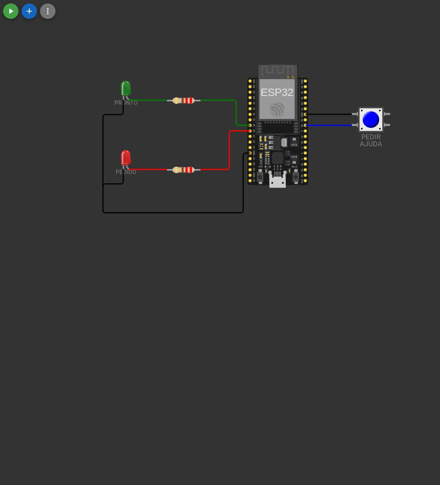

# Alethos: guardião antigolpe | Physical Computing

## Demonstração

- [Simulação do circuito ESP32 no Wokwi](https://wokwi.com/projects/480337469931445249)
- [Vídeo de demonstração no YouTube (3min15s)](https://youtu.be/h70IXoB_XMI)



## Problema e proposta

O Alethos ajuda pessoas idosas a buscar orientação quando recebem uma mensagem suspeita ou são pressionadas a fazer uma transferência. Ao apertar **PEDIR AJUDA**, o ESP32 publica um pedido via MQTT no tópico do projeto. Um serviço receptor pode assinar esse tópico para encaminhar o pedido a um familiar de confiança. Na demonstração, o MQTTX faz o papel de receptor de teste.

Os LEDs mostram o estado da conexão e o resultado da tentativa de publicação. O protótipo demonstra o envio do pedido.

## Integrantes da equipe

- Witalon Antonio Rodrigues — RM 559023
- Alexandre Colvet Delfino — RM 560059
- Enzo Luciano Barros de Oliveira — RM 559557
- Pedro Claudino Scarceli — RM 561023
- Luigi Thiengo Pires — RM 560755

[Lista de integrantes em texto](integrantes.txt)

## Componentes e ligações
- ESP32 DevKit C V4, botão, dois LEDs e dois resistores de 220 Ω.
- Botão entre GPIO18 (terminal `2.l`) e GND.3 (terminal `1.l`): `INPUT_PULLUP`, solto = HIGH e pressionado = LOW.
- GPIO25 → resistor de 220 Ω → ânodo do LED verde; cátodo → GND.1.
- GPIO26 → resistor de 220 Ω → ânodo do LED vermelho; cátodo → GND.1.
- Monitor serial conectado aos pinos TX/RX virtuais. Foram mantidos os componentes, seus valores e os GPIOs de sinal. A disposição e os caminhos dos fios foram organizados para reduzir cruzamentos; os retornos usam pinos GND eletricamente equivalentes.

## Execução
Abra o link, inicie a simulação e aguarde as mensagens “Wi-Fi conectado” e “Broker MQTT conectado”. Clique no botão azul, solte-o e clique novamente. O monitor serial mostra o resultado de cada tentativa. A biblioteca PubSubClient é listada em `libraries.txt`; `WiFi.h` já integra o ambiente ESP32 do Wokwi.

## Indicadores
- Verde aceso: Wi-Fi e conexão MQTT considerados ativos; verde apagado: sem conexão MQTT utilizável.
- Vermelho aceso por três segundos: a chamada de publicação QoS 0 retornou sucesso; isso não prova entrega, leitura ou reação de uma pessoa.
- Vermelho piscando: conexão indisponível ou falha ao publicar; após falha, pisca por três segundos e, se continuar desconectado, segue piscando. Se uma conexão cair durante os três segundos após um envio, a indicação de envio fixo tem prioridade nesse intervalo.
- Serial: registra conexão, tentativas, falhas, pedido e payload enviado.

## MQTT e dados
O ESP32 usa a rede virtual aberta `Wokwi-GUEST`, canal 6. Publica via MQTT sem autenticação e sem criptografia no broker público `test.mosquitto.org`, porta TCP 1883, tópico `citizentech/gs-480337469931445249/pedidos`. O tópico é específico deste projeto, mas público e sem garantia de exclusividade. O client ID inclui um número aleatório de 32 bits por execução para reduzir colisões; colisões ainda são possíveis. O pedido combina essa sessão com um contador. Exemplos são fictícios:

```json
{"dispositivo":"botao-demo-01","pedido_id":"27dab6dc-1","tipo":"pedido_ajuda","descricao":"Duvida sobre possivel golpe digital"}
```

Publicação QoS 0, sem retenção: não há garantia de entrega nem confirmação do broker por mensagem. O retorno verdadeiro de `publish()` indica apenas que a biblioteca aceitou/escreveu a mensagem no transporte; um assinante independente confirmou o recebimento dos exemplos registrados em `evidencias-testes.md`. O broker público e o gateway do simulador não são adequados a dados pessoais ou uso real. Qualquer pessoa pode assinar ou publicar no tópico.

## Lógica e limitações
O programa exige 50 ms de estabilidade e registra apenas a transição para pressionado; solte antes de um novo pedido. Tenta novamente o Wi-Fi a cada 10 s e o MQTT a cada 5 s, sem laços infinitos de espera. As chamadas de rede da biblioteca são síncronas e podem atrasar temporariamente a leitura do botão; o timeout de socket MQTT está definido em 2 s, mas isso não garante limite para todas as etapas de rede. Se estiver desconectado ou a publicação falhar, o pedido é descartado, sem fila ou reenvio: tente novamente após reconectar. A contagem reinicia em cada execução, acompanhada por nova sessão aleatória.

## Teste controlado de falha
No campo de entrada do monitor serial, envie `f` e Enter: o teste altera o destino MQTT para 127.0.0.1, onde não há broker, e desconecta a sessão. Observe as tentativas espaçadas, pressione o botão e confira a falha. Envie `r` e Enter para restaurar o endereço normal; aguarde a reconexão automática e pressione novamente. Esse comando é um recurso de demonstração, não uma simulação de toda falha possível de rede. Reiniciar a simulação restaura a configuração padrão. Consulte `evidencias-testes.md` para os resultados observados.

## Fontes técnicas
- https://test.mosquitto.org/ — portas do broker de testes.
- https://docs.wokwi.com/guides/esp32-wifi — rede e gateway do simulador.
- https://docs.wokwi.com/guides/libraries — bibliotecas no Wokwi.
